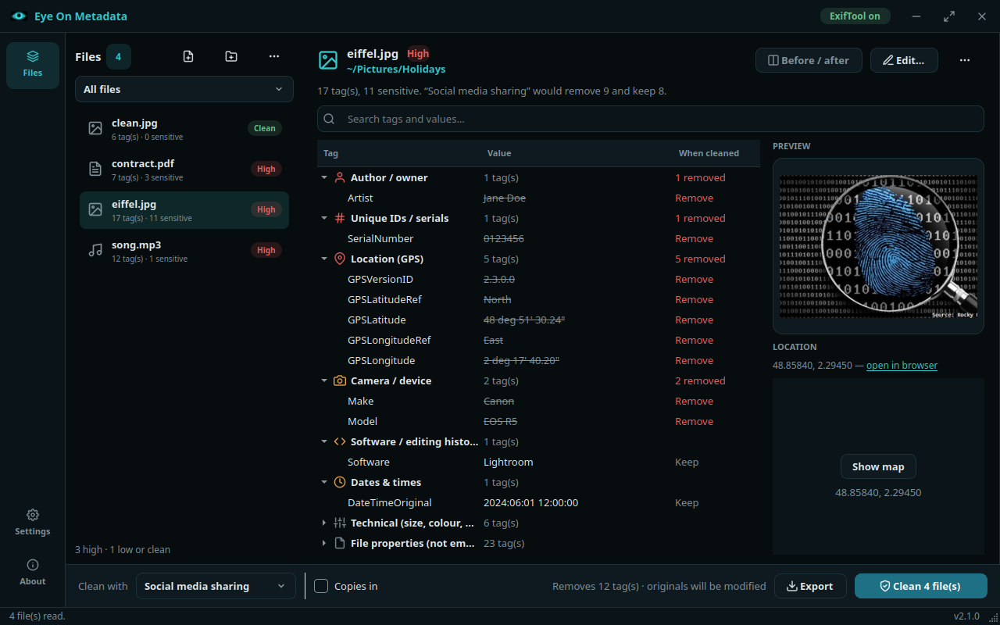
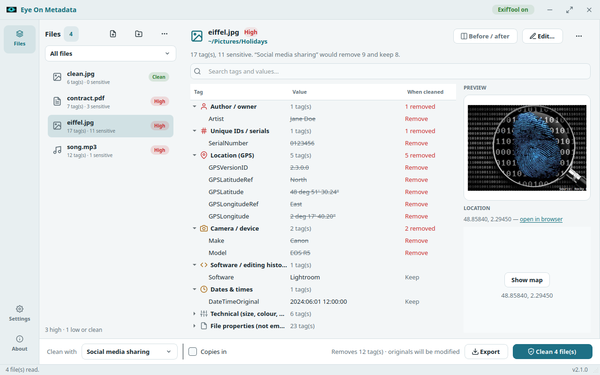
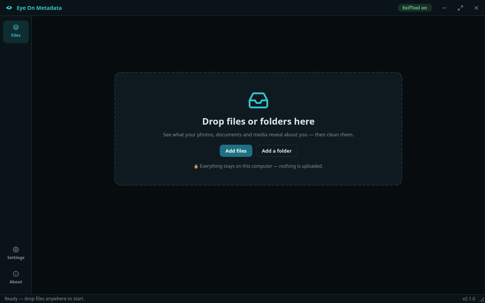

# 👁️ EOM – Eye On Metadata
**EOM (Eye On Metadata)** is a free and open-source desktop application for **viewing, exporting, and removing metadata** from a wide range of media files — images, audio, video, and PDFs.

Cross-platform by design, EOM runs on **Windows**, **Linux**, and **macOS** with a single pre-built binary — no Python or runtime installation required.

## 🖼️ Gallery





## ❓ What is EOM?

Eye On Metadata (EOM) is a lightweight privacy tool that gives you full control over the hidden data embedded in your files. Inspect EXIF data before sharing a photo, see at a glance how much a file reveals about you, strip GPS coordinates or author names, fix a wrong camera clock — all locally, with no upload, no account and no cloud.

### Features

- **Privacy-risk score** — every tag is classified (location, author, serial numbers, device, dates, software, thumbnails…) and each file gets a *High / Medium / Low / Clean* rating. Sensitive tags are highlighted.
- **Selective cleaning** — remove everything, or only what matters, with ready-made profiles: *Remove everything*, *Full anonymity*, *Social media sharing*, *Keep copyright*, *Location only* — or hand-pick categories and individual tags.
- **Safe by default** — write cleaned copies to another folder instead of touching the originals, and get asked before any original is modified.
- **Before / after verification** — every cleaned file is re-read; double-click a result to see exactly what was removed, changed or kept, and the remaining risk.
- **Editing** — set title, author, copyright, description and date, or shift every date by days/hours (wrong camera clock), on one file or a whole folder.
- **Preview & map** — thumbnail of images, PDF first page, Office thumbnails and audio cover art; geotagged files are shown on an OpenStreetMap map (opt-in, see *Privacy*).
- **Export** to JSON, CSV, HTML report or plain text.
- **One workspace**: drag & drop files or folders anywhere, risk filter, tags grouped by category, search, recent files on the start screen, keyboard shortcuts.
- **Command-line interface** for scripts and CI (see below).
- **Right-click menu integration** (Linux file managers, Windows Explorer), **dark / light theme**, **English / French** interface, optional **update check**.

### Supported formats

| Category | Formats |
|----------|---------|
| Images | JPEG, PNG, TIFF, WebP, GIF, HEIC/HEIF¹ |
| Audio | MP3, FLAC, OGG, Opus, WAV, AIFF, M4A, WMA, APE, WavPack |
| Video | MP4, M4V, MOV, MKV, WebM |
| Documents | PDF, DOCX, XLSX, PPTX (author, company, revision authors…) |

¹ HEIC needs ExifTool, or `pip install pillow-heif` for the built-in backend.

### Optional: deeper metadata with ExifTool

If [`exiftool`](https://exiftool.org) is installed on your system, EOM automatically uses it as the primary metadata backend, unlocking XMP, IPTC, MakerNotes, RAW camera tags, and much more. The header bar shows **ExifTool ✓** (green) or **ExifTool ✗** (amber) so you always know which backend is active. Formats ExifTool cannot write (MP3, FLAC, Office…) and PDFs (ExifTool's PDF edits are reversible, so the old values would stay recoverable) are always cleaned by the built-in Python backends.

- **Linux / macOS:** `sudo apt install libimage-exiftool-perl` / `brew install exiftool`
- **Windows:** The pre-built `eom.exe` release already includes a bundled `exiftool.exe` — no separate install needed.

### Privacy

EOM works fully offline. The only network features are **off by default** and can be enabled in *Settings → Privacy & network*:

- loading map tiles from OpenStreetMap (or allowing it once from the map panel),
- checking GitHub for a new release at startup.

## 📥 Download

Pre-built binaries are attached to every [GitHub Release](https://github.com/abogo-nono/eom/releases):

| Platform | File | Requires |
|----------|------|---------|
| Linux x86-64 | `eom-linux-x86_64.zip` | Ubuntu 20.04+ / Debian 11+ |
| Windows x86-64 | `eom-windows-x86_64.zip` | Windows 10+ (includes exiftool.exe) |
| macOS Intel | `eom-macos-x86_64.zip` | macOS 12 Monterey+ |
| macOS Apple Silicon | `eom-macos-arm64.zip` | macOS 14 Sonoma+ |

## 🧭 How it works

Everything happens on one screen:

1. **Drop files or folders** anywhere on the window (or use *Add files* / *Add a folder*, `Ctrl+O`). Folders can include sub-folders (`⋯` menu).
2. The **file list** shows each file's privacy risk (*High / Medium / Low*). Filter it by risk level.
3. Select a file to see its **tags grouped by category** — location, author, serial numbers, device, dates… — with a preview and, for geotagged files, a map. Search with `Ctrl+F`; right-click to copy values.
4. Pick a **cleaning profile** in the bottom bar. Each tag shows live whether it will be **removed** or **kept**. With *Custom…*, tick categories for every file or individual tags for the current one.
5. Optionally tick **Copies in** to keep the originals untouched, then click **Clean** (`Ctrl+Enter`). Select several files to clean only those.
6. Open **Before / after** to see exactly what changed. Use **Export** (JSON, CSV, HTML, text — or *Export, then clean*) and **Edit…** to change fields or shift dates.

## ⌨️ Command line

The same binary (or `python main.py`) works as a CLI when the first argument is a command:

```bash
eom extract photo.jpg --format json            # print metadata (txt, json, csv, html)
eom extract ~/Pictures -r -o report.html       # recursive HTML report
eom risk ~/Pictures -r -v                      # exit code: 0 clean/low, 1 medium, 2 high
eom clean ~/Pictures -r --profile social --output-dir ~/clean
eom clean doc.pdf --categories location,identity --dry-run -v
eom edit photo.jpg --author "Jane" --copyright "CC-BY 4.0" --shift +2h
eom profiles                                   # list profiles and categories
```

Opening the GUI on files: `eom photo.jpg`, `eom --remove a.jpg b.pdf`.

## 🛠️ Report a Bug / Contribute / Suggest a Feature

1. Visit the GitHub repo: [EOM GitHub Repository](https://github.com/abogo-nono/eom)
2. Open an issue for bugs or feature requests
3. Submit a pull request if you’d like to contribute directly

See [AGENTS.md](AGENTS.md) for the developer guide (architecture, build instructions, conventions).

## 👤 Developed by ABOGO Lincoln

Crafted with care and open-source spirit 💡  
[https://github.com/abogo-nono](https://github.com/abogo-nono)
